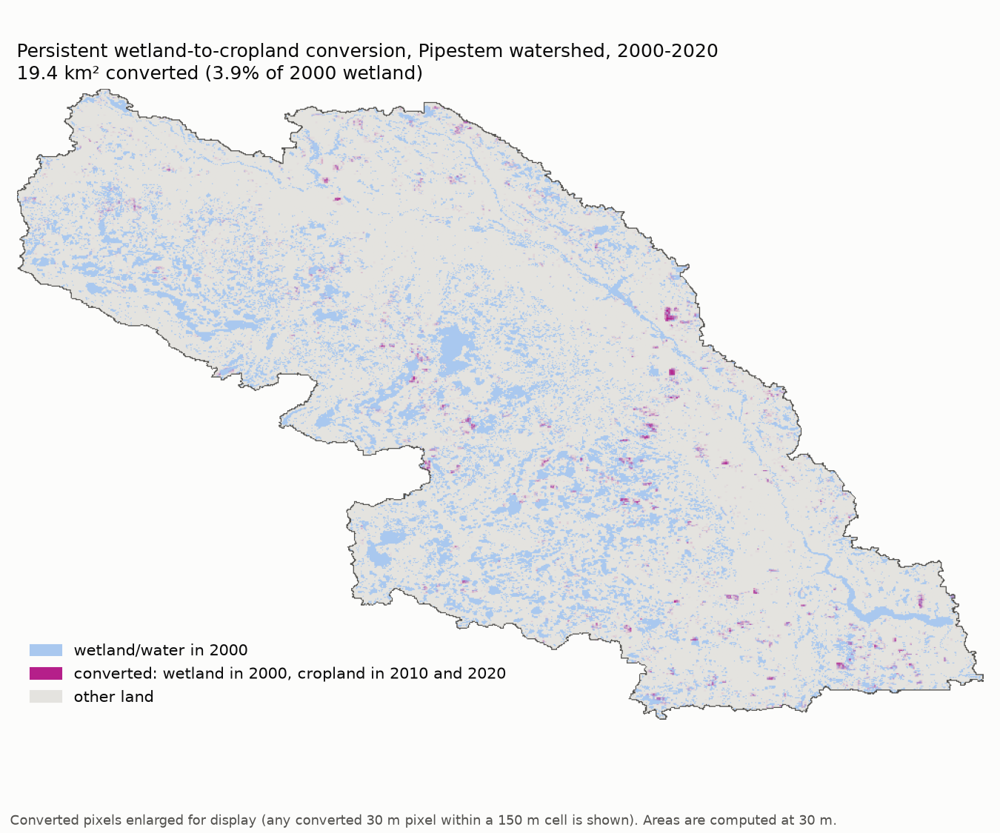
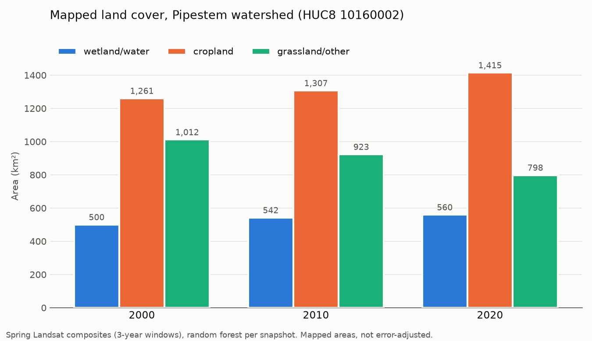
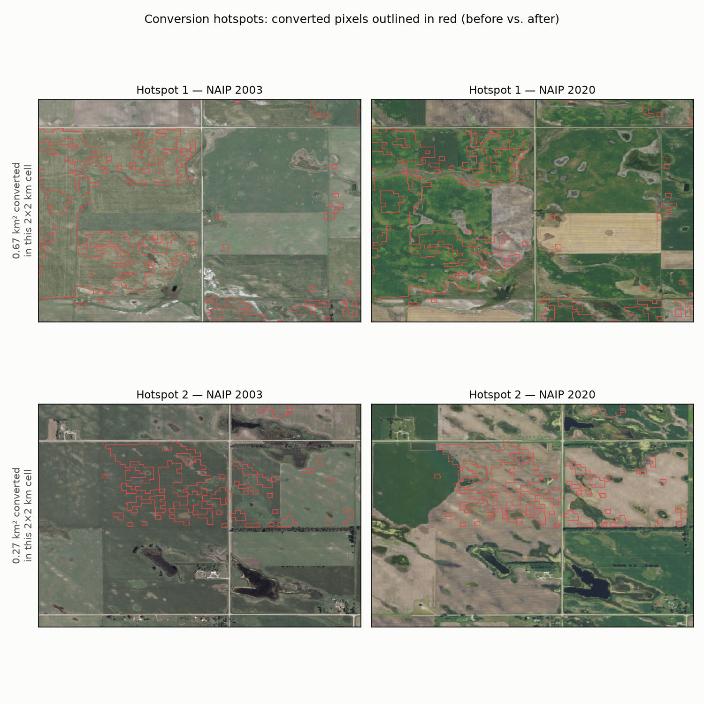
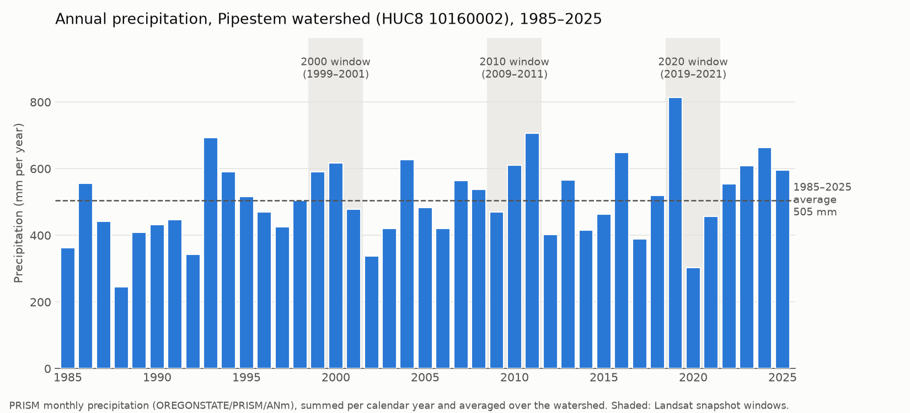

# Wetland Loss to Agriculture in a Prairie Pothole Watershed, 2000-2020

How much wetland in one North Dakota watershed was converted to cropland between 2000 and 2020?

Interactive before/after map: https://liammartin3.github.io/agriculture-wetland-loss/

I built this with Google Earth Engine (Python API and geemap), Landsat imagery and public reference data. All of
the numbers below come from the code in [`wetland_loss.ipynb`](wetland_loss.ipynb).

## Summary

About 19.4 km² of wetland was converted to cropland and stayed that way. These are pixels mapped as wetland or
water in 2000 and as cropland in both 2010 and 2020. That is 3.9% of the 500.2 km² mapped as wetland in 2000.

Over the same period 26.2 km² went the other way (cropland in 2000, wetland in 2010 and 2020), so total wetland
area actually went up. That fits with the run of wetter than average years. Comparing aerial photos from 2003 and
2020, most of the converted areas look like small, shallow basins that are now farmed through rather than large
permanent wetlands.



## Study area

The Pipestem watershed (HUC8 10160002) covers 2,772.5 km² of the James River basin in the Prairie Pothole Region
of North Dakota. I also considered Apple Creek, which is mostly ranchland so there would be less conversion to
find, and Devils Lake, a closed basin where the lake grew a lot during the study period and flooded farmland.

## Data

| Purpose | Dataset |
|---|---|
| Watershed boundary | USGS WBD, `USGS/WBD/2017/HUC08` |
| Imagery | Landsat Collection 2 Level-2 surface reflectance: `LANDSAT/LT05/C02/T1_L2`, `LANDSAT/LE07/C02/T1_L2`, `LANDSAT/LC08/C02/T1_L2` |
| Cropland labels | USDA NASS Cropland Data Layer, `USDA/NASS/CDL` (1999-2001, 2009-2011, 2019-2021) |
| Wetland labels | USFWS National Wetlands Inventory, HUC8 10160002 download (44,854 polygons mapped from 2017-2019 imagery), uploaded as an Earth Engine asset |
| Visual checks | USDA NAIP, `USDA/NAIP/DOQQ` (2003, 2010, 2020) |
| Precipitation | PRISM monthly, `OREGONSTATE/PRISM/ANm` |

## Methods

1. For 2000, 2010 and 2020 I made a median composite of all clear April to June Landsat pixels over a 3-year
   window (1999-2001 and so on), masking cloud, shadow and snow with the `QA_PIXEL` band. The composites use 43,
   57 and 45 scenes, with an average of 14.5, 23.6 and 13.2 clear observations per pixel.
2. Each composite has nine features: the six reflectance bands plus NDVI, MNDWI and Tasseled Cap wetness.
3. Training labels are built separately for each snapshot, in three classes:
   - Wetland/water: inside a non-farmed NWI polygon and never cropped in the three CDL years around the snapshot.
     I sampled 150 points in open water and 150 in emergent marsh so the model wouldn't learn that wetland just
     means open water.
   - Cropland: cultivated in all three CDL years, never fallow, and outside NWI (300 points).
   - Grassland/other: never cultivated, not CDL water or wetland, and outside NWI (300 points).

   The CDL is smoothed with a 3x3 majority filter first, and I only kept pixels where the whole 3x3 block is the
   same class. This avoids mixed pixels at field edges and the speckle in older CDL years.
4. I trained one random forest (200 trees) per snapshot on 70% of its points and tested it on the other 30%. Each
   model then classified its own composite, and the results were saved as Earth Engine assets.
5. From the three maps I calculated class areas, mapped persistent conversion (wetland in 2000, cropland in 2010
   and 2020) with a few plausibility checks, and pulled PRISM precipitation for context.

## Results



| Class (km²) | 2000 | 2010 | 2020 | Change 2000 to 2020 |
|---|---|---|---|---|
| Wetland/water | 500.2 | 542.2 | 559.5 | +59.4 (+11.9%) |
| Cropland | 1,260.6 | 1,307.0 | 1,414.7 | +154.1 (+12.2%) |
| Grassland/other | 1,011.8 | 923.3 | 798.3 | -213.5 (-21.1%) |

The biggest net change is grassland being replaced by cropland. Of the land mapped as wetland in 2000, 78.6% was
still wetland in 2020, 8.8% was cropland and 12.6% was grassland.

I checked the 19.4 km² of conversion three ways:
- 78.9% of it is also cultivated in both 2010 and 2020 in the raw CDL.
- 96.0% is outside any NWI polygon. That is expected, since NWI was mapped in 2017-2019, after these basins were
  already being farmed. Only 2.0% falls inside a non-farmed NWI wetland, which would contradict the result.
- 47.1% is in patches of 11 pixels (about 1 ha) or more, and 17.1% is single isolated pixels that are probably noise.



All three windows were wetter than the 1985-2025 average of 505.0 mm/yr (+11.3%, +18.0% and +3.9%). Spring rain
on its own doesn't explain wetland area, though. The 2020 window had the driest springs (-27.0%) but the most
mapped wetland. My guess is that 2019, the wettest year in the record at 814.0 mm, left the basins full.



## Accuracy

Accuracy on the held-out 30% of each snapshot's points:

| | 2000 | 2010 | 2020 |
|---|---|---|---|
| Overall accuracy | 0.955 | 0.986 | 0.933 |
| Kappa | 0.933 | 0.979 | 0.899 |
| Emergent marsh classified correctly | 0.824 | 0.955 | 0.775 |

Most of the errors are emergent marsh classified as grassland. Compared with the full reference layers for each
period, 87.6-90.4% of NWI wetland area was mapped as wetland and 79.9-90.8% of CDL cultivated land as cropland.
The confusion matrices are in `outputs/confusion_matrix_<year>.csv`.

## Limitations

- 30 m pixels are coarse for prairie potholes. 31.1% of the NWI polygons in the watershed are smaller than one
  Landsat pixel (the median polygon is 0.40 acres), so many potholes get mixed with the land around them or
  missed.
- The maps really show what was wet in spring. A 3-year spring median picks up surface water and marsh
  vegetation, so ground that was only flooded temporarily can be mapped as wetland. Some of the "conversion" is
  probably grassland that held water in the spring of 1999-2001 and was cropped later (hotspot 1 above looks like
  this).
- The accuracy numbers are optimistic. The test points come from the same strict rules as the training points,
  so they are the easy cases, and a random split leaves test points close to training points. Field edges, small
  basins and fallow fields are not really tested. The areas are mapped areas, not error-adjusted estimates.
- The reference data have their own dates and errors. NWI is from 2017-2019, so using it for 2000 and 2010
  assumes those wetlands were already there. Older CDL is noisier, and the 2000 map agrees with CDL less than the
  later ones (79.9% vs 90.8% in 2010).
- 2000 and 2010 use Landsat 5 and 7, while 2020 uses Landsat 8, and I didn't apply a cross-sensor adjustment.
  Because each snapshot has its own model, each model learns its own sensor's values, which avoids most of the
  problem.
- I originally planned to start in 1990, training one model on 2020 and applying it to every year. That model
  mapped roughly 30-57% of the watershed as wetland in 1990-2010, compared with about 20% in 2020, including
  wetlands shaped like fields in the dry 1989-1991 window right after the 1988 drought. Adding a Landsat 8 to
  Landsat 7 adjustment or using only the indices didn't fix it
  ([`scripts/diagnose_transfer.py`](scripts/diagnose_transfer.py)). The CDL goes back to 1997 here, so I narrowed
  the study to 2000-2020, where every snapshot can have its own labels.

## Next steps

- Use spatially blocked cross-validation and an independent sample interpreted from aerial photos, then report
  error-adjusted areas (Olofsson et al. 2014).
- Go back to 1990 using labels that don't depend on the CDL, for example by carrying over training points whose
  spectra stay stable between years.
- Use every spring image instead of a single median, or add fall imagery, to separate wet fields from marsh.
- Try Sentinel-2 (10 m) from 2016 on to pick up smaller potholes.

## Repository

| Path | Contents |
|---|---|
| `wetland_loss.ipynb` | The full workflow, steps 0 to 9 |
| `scripts/prepare_nwi.py` | Clips the USFWS NWI download to the watershed and prepares it for upload to Earth Engine |
| `scripts/diagnose_transfer.py` | The test that led me to drop 1990 |
| `outputs/figures/` | Charts and maps |
| `outputs/rasters/` | `landcover_2000.tif`, `landcover_2020.tif` and `conversion_2000_2020.tif` (30 m, EPSG:5070; 0 wetland/water, 1 cropland, 2 grassland/other, 255 no data) |
| `outputs/*.csv` | Areas, accuracy, confusion matrices, precipitation and training points (GeoJSON) |
| `docs/` | The GitHub Pages map (Leaflet). The files in `docs/data/` are written by the notebook. |

## Running it yourself

```bash
python3.12 -m venv .venv && .venv/bin/pip install -r requirements.txt
.venv/bin/earthengine authenticate
# download https://documentst.ecosphere.fws.gov/wetlands/downloads/watershed/HU8_10160002_Watershed.zip
# and unzip it into data/raw/nwi/, then:
.venv/bin/python scripts/prepare_nwi.py
# upload data/processed/nwi_pipestem.zip as an Earth Engine table asset
# (Code Editor: Assets > NEW > Shape files)
.venv/bin/jupyter lab wetland_loss.ipynb
```

You need a Google Cloud project registered for noncommercial Earth Engine use. Set `PROJECT_ID` and the asset
paths in the notebook to your own. To view the map locally, run `python3 -m http.server` inside `docs/`.
